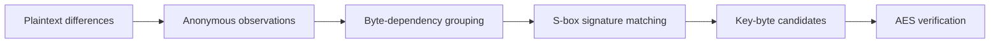

# SAGE
### Sparse Anonymous Grouping and Extraction for AES Subround Leakage

**Can a small set of scan-visible bits reveal an AES key even when their register identities and ordering are unknown?** SAGE explores this question by identifying observations through their responses to chosen plaintext differences, rather than through their physical scan positions.

Short differential signatures group anonymous observations by plaintext-byte dependency. AES S-box templates narrow the key-byte candidates, and a plaintext/ciphertext check resolves the remaining combinations.

This repository provides a self-contained C++ implementation and synthetic experiments. You can explore query budget, partial visibility, signature noise, and sparse observation coverage without an EDA installation.

## How it works



The modeled pool contains 384 bits: 128 each from initial AddRoundKey, first-round SubBytes, and first-round ShiftRows. With K differences per plaintext byte, acquisition uses `1 + 16K` plaintexts.

See [Method](docs/METHOD.md) for the observation model and recovery procedure.

## The central idea

An unknown scan position still carries a recognizable input dependency. Changing one plaintext byte lets SAGE associate responsive observations with that byte, without assigning them RTL register names. The differential form also distinguishes key-independent initial AddRoundKey responses from the nonlinear S-box signatures used for recovery; ShiftRows relocates those signatures without changing their byte-local function.

The goal is not to reconstruct the entire internal state. It is to gather enough informative signatures to narrow sixteen key-byte candidate sets, then use AES verification to resolve the remaining combinations. Longer signatures reduce ambiguity, while sparse visibility trades acquisition coverage against the remaining search. This is why the experiments report candidate sizes and search effort alongside recovery success—not just a final key.

## Quick start

Requirements: C++17 compiler, Make, and Python 3. No third-party Python packages.

```sh
python3 scripts/reproduce.py
```

The launcher builds the code, runs eight unit checks, and executes ten trials for each of five configurations. The captured configuration produces 50 successful key-recovery trials. Logs and CSVs are written to `results/reproduced/`.

```sh
make test                              # Unit checks only
python3 scripts/verify_sources.py      # Source snapshot integrity
```

If static C++ runtime libraries are unavailable, build with `make LDFLAGS= test bin/test_hybrid` first.

## Experiments

| Configuration | K | Plaintexts | What it explores |
|---|---:|---:|---|
| Full visibility, short signatures | 4 | 65 | Query budget versus remaining search |
| Full visibility, longer signatures | 8 | 129 | Candidate separation |
| 50% visibility | 8 | 129 | Missing observations |
| 1% signature-bit noise | 8 | 129 | Approximate matching |
| One informative tap per byte group | 12 | 193 | Recovery with 16 selected observations |

The sparse configuration assumes informative coverage of every byte group; arbitrary sets of sixteen physical taps need not provide it. Noise is applied to signatures after grouping. See [Experiments](docs/EXPERIMENTS.md) for exact settings.

## Reading the results

Each trial reports recovery status, byte-candidate sizes, remaining search-space bits, and complete keys evaluated. The launcher calculates these directly from experiment output; no paper table is needed.

A captured run is in [`evidence/reproduced/`](evidence/reproduced/). Start with `summary.csv`, then inspect `trials.csv` and `hybrid_output.txt`.

## Repository layout

| Path | Contents |
|---|---|
| `src/`, `include/` | AES model and signature-analysis helpers |
| `tests/` | Unit checks and five-configuration hybrid experiment |
| `scripts/` | Experiment launcher and integrity checker |
| `docs/` | Method, experiment guide, source provenance |
| `evidence/` | Captured experiment outputs |

The executable artifact covers software-modeled subround observations and recovery. Physical scan acquisition, gate-level timing, and device measurements are outside this package.

## Research

**SAGE: Sparse Anonymous Grouping and Extraction for AES Subround Leakage**

Jincheol Jeong and Hayoung Lee

For controlled research and evaluation of designs you are authorized to test. A distribution license has not yet been assigned.
